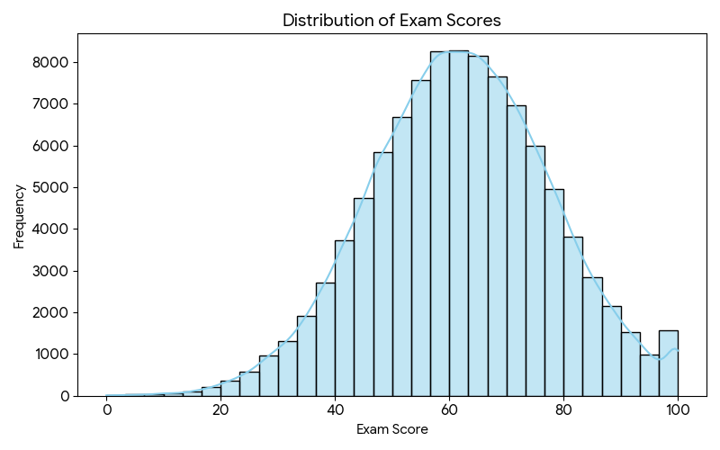
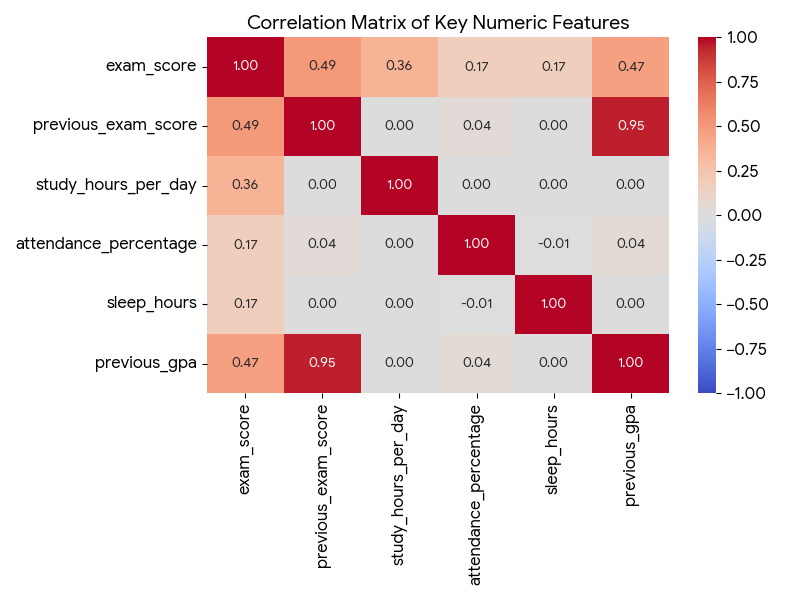
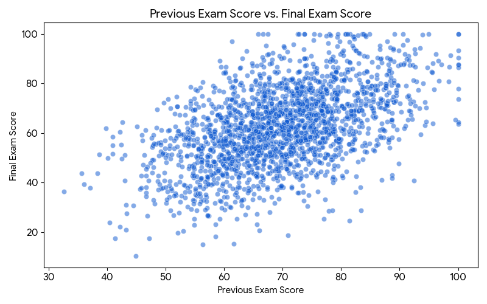
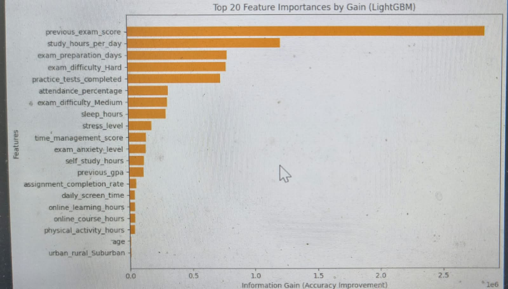
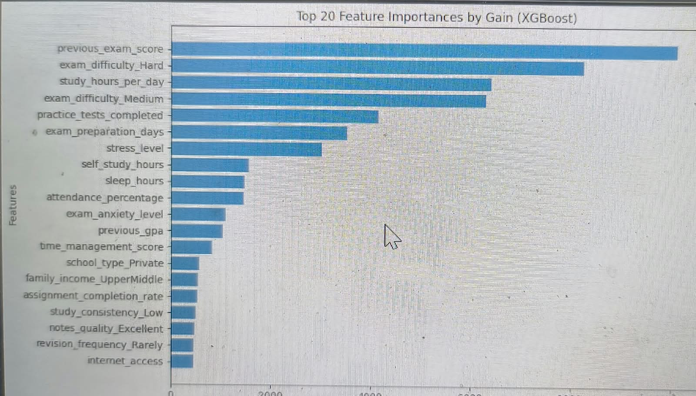
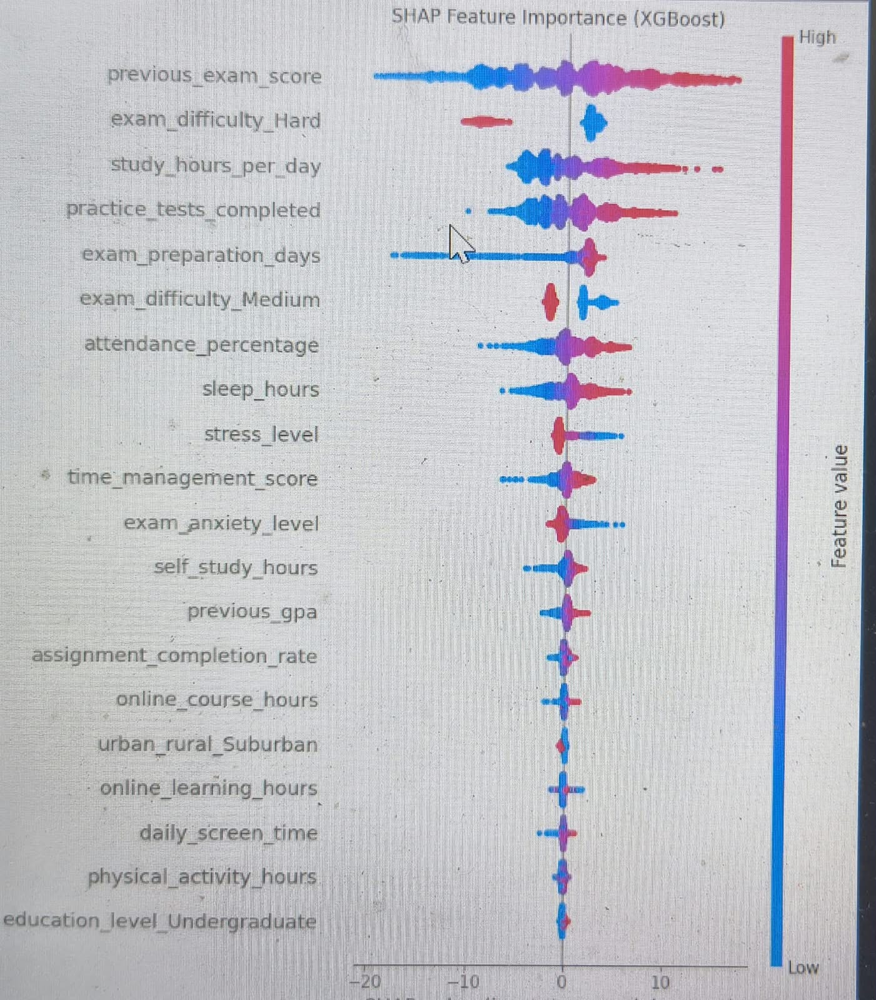

# 🎓 Heterogeneous Ensemble Model for Student Exam Performance Forecasting

## 📌 Project Overview
This project focuses on predicting continuous student exam scores based entirely on pre-exam behavioral, demographic, and academic indicators. By benchmarking traditional algorithms (Decision Trees, SVR) against advanced Gradient Boosting frameworks (XGBoost, LightGBM) and Heterogeneous Ensembles (Voting, Stacking), this repository provides a comprehensive end-to-end Machine Learning pipeline. 

The final predictive model is deployed as an interactive web application on an **AWS EC2** instance using **Streamlit**.

## 📊 Dataset & Exploratory Data Analysis
* **Source:** [Kaggle - Student Exam Performance Dataset](https://www.kaggle.com/datasets/ssssws/student-exam-performance-dataset)
* **Initial Shape:** 100,000 records, 44 features
* **Sampled Shape:** 10,000 records (optimized for rapid experimentation and limited cloud compute)
* **Target Variable:** `exam_score` (Continuous)

### Data Visualization
Before modeling, we explored the underlying distributions and relationships within the data.

**1. Distribution of Exam Scores**

**2. Correlation Matrix of Key Numeric Features**

**3. Previous Exam Score vs. Final Exam Score**

## 🛠️ Data Preprocessing & Feature Engineering
A critical component of this project was ensuring the model could generalize to unseen, real-world data without cheating.
1. **Target Leakage Removal:** Dropped post-exam variables (`questions_correct`, `questions_attempted`, `performance_grade`, `pass_status`) which initially inflated the $R^2$ score to >0.98.
2. **Missing Value Imputation:** Handled missing data in `previous_gpa`, `attendance_percentage`, and `time_management_score` using **Median Imputation**.
3. **Categorical Encoding:** Applied **One-Hot Encoding** (`pd.get_dummies`) with `drop_first=True` to eliminate multi-collinearity among nominal features.
4. **Feature Scaling:** Applied `StandardScaler` to numerical features to optimize convergence and distance calculations for the Support Vector Regressor (SVR).

## 🧠 Model Architecture & Training
We trained and evaluated multiple base and ensemble models:
* **Support Vector Regressor (SVR):** RBF Kernel, $C=1.0$, $\epsilon=0.1$.
* **Decision Tree Regressors (DT):** Depths of 7 and 8 to capture non-linear relationships.
* **Voting Ensemble:** Averaged predictions between the SVR and DT.
* **Stacking Ensemble:** Utilized 2 DTs and 1 SVR as base estimators, with a **Linear Regression** meta-model to learn the optimal weighted combination via 5-fold Cross-Validation.
* **Gradient Boosting:** Trained **XGBoost** and **LightGBM** (`n_estimators=100`, `learning_rate=0.1`, `max_depth=5`) for robust sequential error correction.

## 📈 Performance Metrics
Evaluation was performed on a 20% hold-out test set using RMSE (Root Mean Squared Error) and $R^2$ (Coefficient of Determination). 

| Model Configuration | $R^2$ Score | RMSE |
| :--- | :---: | :---: |
| **LightGBM** | **0.6452** | **9.3866** |
| **XGBoost** | **0.6434** | **9.4098** |
| Stacking Ensemble (Linear Meta-Model) | 0.6039 | 9.9178 |
| Voting Ensemble (SVR + DT) | 0.5715 | 10.3158 |
| SVR (Individual) | 0.5713 | 10.3174 |
| Mixed Ensemble (2 DTs + 1 SVR) | 0.5487 | 10.5866 |

*Note: The predictive ceiling ($R^2 \approx 0.64$) reflects a highly realistic benchmark for human behavioral data, free of target leakage.*

## 🔍 Model Interpretability
To look inside the "black box" of our highest-performing models, we utilized **SHAP (SHapley Additive exPlanations)** and Information Gain metrics. The models confirm pedagogical intuition: historical academic performance and consistent daily effort are the strongest indicators of future exam success.

**1. Feature Importance by Gain (LightGBM)**

**2. Feature Importance by Gain (XGBoost)**

**3. SHAP Analysis Summary (XGBoost)**

## 👨‍💻 Contributors
* **Shreyas Snehal** 

